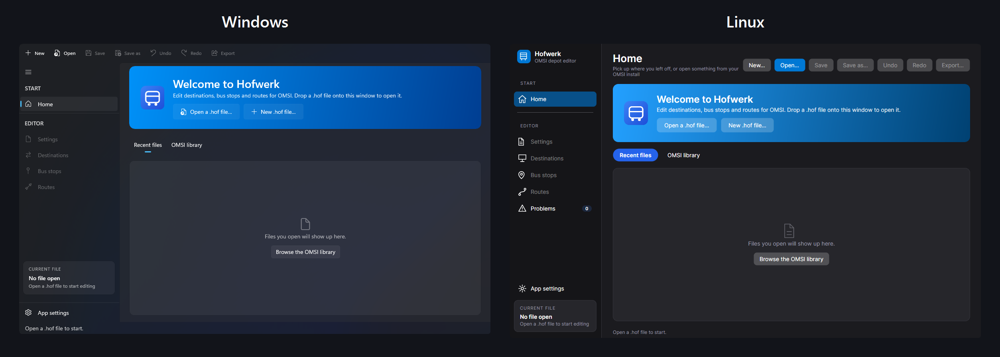

<!-- languages -->
<p align="center"><b>English</b> · <a href="translations/de/README.md">Deutsch</a></p>
<!-- /languages -->

<p align="center"></p>

# Hofwerk

A modern editor for the **`.hof` files of OMSI 2**: the destination displays, bus stops and routes that let one bus
model run on many lines. The name is German for "depot works" (*Hof* is OMSI's word for a depot). Hofwerk is a new
implementation of the 2018 HOF Suite (see [Credits](#credits)).

- **Windows:** native WinUI 3 app (Mica, light and dark mode). If it does not work on a computer, Hofwerk can switch to a second
  version drawn with Avalonia, downloaded when needed.
- **Linux:** Avalonia app that shares all logic with the Windows one. *Builds, but has not been tested on Linux yet.*



## Why I made Hofwerk

HOF Suite is how most of the OMSI community learned to make `.hof` files without editing text by hand, and it has not been
updated since 2019. It only runs on Windows, and more and more people play on Linux or on a Steam Deck. I wanted a `.hof`
editor that looks and feels like today's software, keeps working for files made with HOF Suite, and runs on both systems, so
that nobody has to boot Windows or keep a virtual machine just to change a destination.

Linux gaming is growing. Valve's Steam Hardware Survey (people who choose to take it) had Linux at
[2.64% in August 2025 and 3.90% in August 2026](https://gamingonlinux.com/2026/08/linux-back-over-4-percent-in-the-july-2026-steam-survey),
and it
[passed 5% for the first time](https://linuxiac.com/linux-make-history-hitting-five-percent-usage-on-steam/) in the March 2026
survey. The number moves from month to month, and it is only Steam users who answered, so it is a sign of direction and not
an exact count. OMSI 2 itself is a Windows game, so Linux players run it through a compatibility layer such as Steam's Proton.
Their `.hof` files are the same files, and they deserve a native editor.

## What it does

- Opens and saves `.hof` files while keeping their original encoding (Windows-1252 or UTF-8).
- Edits destinations, bus stops and routes, and the depot's **Settings**: general settings (display name and service
  trip destination), the announcement / roll sign / side plate **folders** (with a tick when the folder exists in your
  OMSI install) and the **IBIS codes**.
- **Export to several folders:** the Settings page lists the vehicle folders a file belongs in (saved in the file, the way
  HOF Suite does it), and **Export** puts the file into all of them in one go, with a progress bar and a result for each folder.
- **Undo and redo** for everything in the file, optional **autosave**, and a question before closing with unsaved changes.
- Home screen with your recent files and every `.hof` of your Steam OMSI install (Windows, Linux, Flatpak and extra
  library drives).
- **Import from an OMSI map:** pick a map (shown by its picture and name, as in OMSI) and Hofwerk fills in its bus stops,
  destinations and routes, for a new file or added to the file you have open. A single timetable file (`.ttp`) can be added as one route.
- **String presets:** names for the string slots ("IBIS 1", "ANNAX (side)" …) so you do not have to remember what
  "String 7" means. Import a strings file of your own (Hofwerk asks what is in it), or see [`Presets/`](Presets/README.md)
  to add one through a pull request.
- **English and German**, in the app and in the installer. Hofwerk follows your system's language until you choose one ([Deutsch](translations/de/README.md)).
- **Updates inside the app**, light and dark themes, a "What's new" for every version, and an error window with a
  ready-made bug report.

**V1** is the release that does everything HOF Suite does (the versions before it were called `V1-dev1` to `V1-dev5`). See the
[roadmap](ROADMAP.md) for what is done and what comes next, and the [changelog](CHANGELOG.md) for what changed in each version.

## Hofwerk and HOF Suite

[HOF Suite](https://gitlab.com/omsi2/hof-suite) (Lukas G., 2018-2019) is the editor Hofwerk is modelled on. Hofwerk reads and
writes the same `.hof` files, so you can switch between them. The list is based on HOF Suite's public changelog and source
layout (see the [roadmap](ROADMAP.md)), so a detail may be missing.

| | HOF Suite | Hofwerk |
| --- | --- | --- |
| Systems | Windows | **Windows and Linux** (Linux not tested on a real desktop yet) |
| Edit destinations, bus stops, routes, depot settings | Yes | Yes |
| Keeps the file's encoding, lists problems in a file | Yes | Yes |
| Names for the string slots | Templates | String presets, built in and shared in `Presets/`, and import of your own strings file |
| New file from an OMSI map | Yes (*Import map*) | Yes, with the map's picture and name. Only for a new file so far |
| Import a map into an existing file, import a single trip | Yes | Yes, nothing is added twice and Undo takes it back |
| Export one file to several bus folders (the list is kept in the file) | Yes | Yes, with a backup of replaced files |
| Station links (timetable files that write their stops as numbers) | Yes | Yes |
| Translations | English and German | English and German; [add a language](src/Hofwerk.Installer.Engine/Languages/README.md) |
| Updates inside the app, "What's new" | Not in its changelog | Yes |
| Light, dark and system theme | Not in its changelog | Yes |
| Undo and redo, autosave, a question before closing with unsaved changes | Not in its changelog | Yes |
| New files carry a plain-words guide to each section | Not in its changelog | Yes |
| Error window with a ready-made bug report | Not in its changelog | Yes |
| Second Windows version for computers where WinUI fails | Not applicable | Yes (the Avalonia one, downloaded when needed) |
| Installer | Setup program | One-file installers, online or offline, no administrator rights |

Hofwerk 1 does everything in this table. From here it goes beyond HOF Suite (see the roadmap).

## Install

Download the installer for your system from the Hofwerk website (the Download page; the same files are on the [Releases](../../releases) page). Each one is a single file. On Windows there are
two: `Hofwerk-Setup-<version>-win-x64.exe` has the app inside (works offline), and `Hofwerk-WebSetup-<version>-win-x64.exe` is
small and downloads the app while it installs. Both show their steps: Download, Extract, Move files, Cleanup, Close.

- **Windows:** `Hofwerk-Setup-<version>-win-x64.exe`. Double-click it. It installs just for you (no administrator
  rights), adds a Start menu entry, and can add a desktop shortcut and offer Hofwerk in "Open with" for `.hof`
  files. Remove it from Windows' *Installed apps* or with the uninstaller in the install folder. The installer is not
  code-signed yet, so Windows SmartScreen may ask you to choose *More info → Run anyway*.
- **Linux:** `Hofwerk-Setup-<version>-linux-x64.tar.gz`. Unpack it and run the file inside:

  ```bash
  tar -xzf Hofwerk-Setup-*-linux-x64.tar.gz
  ./Hofwerk-Setup-*-linux-x64
  ```

  It installs to `~/.local/share/hofwerk`, adds Hofwerk to your applications menu and a `hofwerk` command. The menu
  entry has an *Uninstall Hofwerk* action. *Not tested on a real Linux desktop yet.*

For scripts, both installers also run without a window:
`Setup --silent [--dir PATH] [--language de] [--desktop-shortcut] [--file-association]`, and `Uninstall --silent --uninstall`.

## Build

You need the [.NET 10 SDK](https://dotnet.microsoft.com/download).

```bash
./test.ps1                                             # all tests; see tests/README.md
dotnet run --project src/Hofwerk.WinUI -r win-x64      # Windows
dotnet run --project src/Hofwerk.Linux                 # Linux (also runs on Windows)
```

To build the installer yourself (PowerShell 5.1 or 7; the result lands in `dist/`):

```powershell
pwsh installer/build-installer.ps1 -Rid win-x64 -Version 0.1.0
```

## Project layout

| Folder | What is in it |
| --- | --- |
| `src/Hofwerk.Core` | `.hof` parser and writer, OMSI/Steam locator, recent files, preset library. No UI. |
| `src/Hofwerk.ViewModels` | Everything the screens show and do, shared by both front ends. |
| `src/Hofwerk.WinUI` | Windows front end (WinUI 3). |
| `src/Hofwerk.Linux` | Linux front end (Avalonia). |
| `src/Hofwerk.Installer.Engine` | Installing and uninstalling: copying files, shortcuts, registry or menu entries. No UI. |
| `src/Hofwerk.Installer` | The setup window (Avalonia). The same program, without the app attached, is the uninstaller. |
| `installer/` | Scripts that build the one-file installers and test them the way a user meets them (UI Automation). |
| `Presets/` | String presets built into the app. One folder per preset. |
| `tests/` | Unit tests, including a round-trip check against real OMSI files when OMSI is installed. Run them with `./test.ps1` ([how](tests/README.md)). |
| `docs/` | Pictures used in this README and on the website. |
| `website/` | The website: downloads, what is new, comparison, roadmap. See [website/README.md](website/README.md). |

## Releases

Pushing a tag such as `V1-dev3` runs the tests, builds the Windows and Linux installers, tests them, and publishes them as a
GitHub release (`.github/workflows/release.yml`). The website (`.github/workflows/website.yml`) then copies the newest installers onto its Download page. The release has the installers, the packed app that in-app updates download
(`Hofwerk-App-*.hwpack`), the packed second Windows version (`Hofwerk-Compat-*.hwpack`), and notes taken from the matching
section of [CHANGELOG.md](CHANGELOG.md). Move the notes from `[Unreleased]` to a new version heading before tagging; a check on every pull
request makes sure each version has notes.

## Thank you

A big thank you to **Lukas G.**, the creator of the original **HOF Suite**, for the inspiration to build Hofwerk.
The original tool made `.hof` files approachable for the whole OMSI community, and it has not been updated since 2019.
I wanted to carry that idea forward with a modern interface for today's Windows and Linux players.

Thanks also to everyone in the OMSI community who makes and shares buses, maps and add-ons, and to everyone who
contributes string presets.

## Credits

- The original **HOF Suite** by **Lukas G.** (© 2018): https://gitlab.com/omsi2/hof-suite. The "HOF Suite Default"
  preset is taken from it. Hofwerk is a new codebase, not a fork. Its license requires attribution, links to the
  original and public source; details in [THIRD_PARTY_NOTICES.md](THIRD_PARTY_NOTICES.md).
- Everyone credited in [THIRD_PARTY_NOTICES.md](THIRD_PARTY_NOTICES.md) for string presets.
- OMSI 2 is a product of its respective owners. This project is not affiliated with them.
